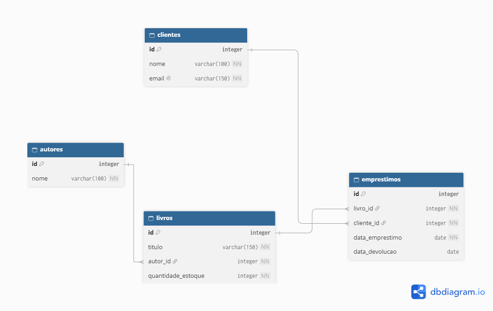

# **BookStore Manager CLI**

**Sobre o projeto**

A aplicação deverá permitir o gerenciamento das informações da livraria por meio de menus interativos no terminal, mantendo os dados em memória durante a execução. Além da aplicação, deverá ser entregue o projeto do banco de dados da livraria (DER e script SQL), executado diretamente no PostgreSQL. 

**\*Importante: a aplicação não se conecta ao banco de dados.**

**Objetivo**

**Praticar os principais conceitos da segunda parte do Módulo 01:**

**- Node.js;**

**- JavaScript no back-end;**

**-TypeScript;**

**-Interfaces;**

**-Funções tipadas;**

**-Classes;**

**-Arrays;**

**-Objetos;**

**-Métodos de array;**

**-Async/await**

**-Promises;**

**-Tratamento de erros;**

**-Arquitetura em camadas;**

**-Injeção de dependência pelo construtor;**

**-Clean Code;**

**-DRY;**

**-Seed de dados;**

**-Banco de dados relacionar;**

**-GitHub;**

**-GitFlow;**

**-Kanban.**

**Tecnologias utilizadas**

**-Node.js**

**-TypeScript**

**-TSX**

**-Módulo nativo readline/promises**

**-PostgreSQL**

**-Git**

**-GitHub**

**Requisitos para execução**

**Antes de executar o projeto, é necessário ter instalado:**

**-Node.js**

**-npm**

**-PostgreSQL**

**-Git** 

**Execução do script SQL no PostgreSQL**

O  arquivo database/script.sql está organizado em três seções, na ordem: DDL (criação das tabelas), DML (INSERT, UPDATE, DELETE e SELECT) e consultas dos relatórios.

Pelo pgAdmin: crie o banco bookstore, abra a Query Tool, carrega o script.sql e execute (F5).

**Imagem do DER**

https://github.com/EvandroCon/BookStore-Manager-CLI/blob/main/database/diagrama.png?raw=true

**Instalação**

**Clone o repositorio:**

git clone [https://github.com/EvandroCon/BookStore-Manager-CLI.git](https://github.com/EvandroCon/BookStore-Manager-CLI.git)

cd bookstore-manager-cli

**Instale as dependências**

npm install

Execução

Execute o projeto em ambiente de desenvolvimento:

npm run devolução

Para compilar o projeto (gerar os arquivos javascript):

npm run build

**Arquitetura do projeto**

Usuario → Menu (navega)→ Controller (lê/mostra no terminal)→ Service (regras de negócio)→ Repository (armazena e recupera)→ Dados em memória (Map)

**Funcionalidades implementadas**

Autores: cadastrar, listar, consultar, atualizar e remover.

Clientes: cadastrar, listar, consultar, atualizar e remover.

Livros: cadastrar, listar consultar por ID, atualizar e remover.

Emprestimos: cadastrar, listar, consultar, atualizar, registrar, remover.

**Regras de negócio e validações**

-Autor, livro, cliente e empréstimo inexistentes geram mensagem clara.

-Livro só pode ser cadastrado para um autor existente.

-Empréstimo exige livro existente, cliente existente e exemplar disponível.

-Devolução só para empréstimo existente e não devolvido, atualizando a quantidade.

-E-mail de cliente recusa registros duplicados.

-Campos obrigatórios.

-Tamanho máximo no título do livro, autor e cliente.

-Remoção de empréstimo pede confirmação.

**Estrutura de pastas**

bookstore-manager-cli/

├── database/

│   ├── diagrama.png

│   └── script.sql

├── src/

│   ├── main.ts

│   ├── controllers/

│   │   ├── AutorController.ts

│   │   ├── ClienteController.ts

│   │   ├── EmprestimoController.ts

│   │   └── LivroController.ts

│   ├── data/

│   │   └── seed.ts

│   ├── menus/

│   │   ├── MenuPrincipal.ts

│   │   ├── MenuAutores.ts

│   │   ├── MenuClientes.ts

│   │   ├── MenuEmprestimos.ts

│   │   └── MenuLivros.ts

│   ├── models/

│   │   ├── Autor.ts

│   │   ├── IAutor.ts

│   │   ├── Cliente.ts

│   │   ├── ICliente.ts

│   │   ├── Emprestimo.ts

│   │   ├── IEmprestimo.ts

│   │   ├── Livro.ts

│   │   └── ILivro.ts

│   ├── repositories/

│   │   ├── AutorRepository.ts

│   │   ├── ClienteRepository.ts

│   │   ├── EmprestimoRepository.ts

│   │   └── LivroRepository.ts

│   ├── services/

│   │   ├── AutorService.ts

│   │   ├── ClienteService.ts

│   │   ├── EmprestimoService.ts

│   │   └── LivroService.ts

│   └── utils/

│       ├── exibirErro.ts

│       └── lerNumero.ts

├── .gitignore

├── package.json

├── tsconfig.json

└── README.md

**Exemplos de utilização**

**Realizar um empréstimo(Menu principal→ 4 Emprestimos → 1 Realizar empréstimo):**

ID do livro: 1

ID do cliente: 1

Data do empréstimo (AAAA-MM-DD): 2026-10-08

Empréstimo registrado com sucesso!

ID do empréstimo: 8

**Tentar emprestar um livro sem exemplares (o sistema avisa e continua funcionando):**

ID do livro: 2

ID do cliente: 1

Data do empréstimo (AAAA-MM-DD): 2026-08-10

Erro: Não há unidades disponíveis deste livro.

**Registrar uma devolução(Menu principal → 4 Empréstimos → 2 Registrar devolução):**

ID do empréstimo: 2

Data da devolução (AAAA-MM-DD): 2026-10-06

Devolução registrada com sucesso!

A quantidade em estoque do livro foi atualizada.

**Listar livros(Menu principal → 2 Livros → 2 Listar livros):**

ID: 1 | Título: Dom Casmurro | Autor ID: 1 | Estoque: 1 

ID: 2 | Título: Harry Potter e a Pedra Filosofal | Autor ID: 2 | Estoque: 1 

ID: 3 | Título: 1984 | Autor ID: 3 | Estoque: 2 

**Integrantes da equipe:**

Evandro Conceição

**Kanban:**

[https://trello.com/b/3xLeQYVH/bookstore-manager-cli](https://trello.com/b/3xLeQYVH/bookstore-manager-cli)

